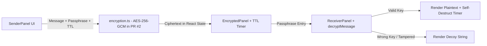

# SecretSnap — Client-Side Secret Sharing UI (Web Crypto AES-256-GCM)

> A browser-only confidential note sharing demo built with React 18, TypeScript, Vite, and Tailwind CSS, featuring guided 3-step encryption/decryption UI and client-side TTL expiration.

[](https://www.typescriptlang.org/)
[](https://react.dev/)
[](https://tailwindcss.com/)
[](https://developer.mozilla.org/en-US/docs/Web/API/Web_Crypto_API)

---

## Executive Overview

**SecretSnap** is a front-end privacy application demonstrating client-side secret protection, TTL-based UI destruction, and decoy output on wrong-key decryption attempts. All state (`encryptedMessage`, passphrase input, and TTL countdown) stays inside React browser memory (`src/components/SecretSnap.tsx`)—there is no backend server database or cross-device storage in this repository.

> **Branch & Security Status (`main` vs. Draft PR #2):**
> - On `main`: `src/utils/encryption.ts` uses demo Base64 encoding (`mockEncrypt` / `mockDecrypt`) with a plaintext passphrase check.
> - On open Draft PR #2 (`maintenance/repository-quality-improvements`): replaces mock encoding with Web Crypto **PBKDF2-SHA256** (100,000 iterations, 16-byte random salt) + **AES-256-GCM** (12-byte random IV, `v1.<salt>.<iv>.<ciphertext>` envelope), fixes timer cleanup leaks and ESLint/Tailwind errors, adds `vitest` unit tests (`src/utils/encryption.test.ts`), and adds `.github/workflows/quality.yml`.

---

## Core Capabilities & Architecture

### Implemented UI & Cryptographic Features
- **3-Step Guided Flow (`StepIndicator.tsx`):** Send/Encrypt -> Encrypted Payload & Shareable Preview Link -> Receive/Decrypt.
- **Sender Panel (`SenderPanel.tsx`):** Message composer, random key generator (`generateSecretKey`), and TTL expiration selector.
- **Encrypted Display & Countdown (`EncryptedPanel.tsx`):** Displays ciphertext envelope and countdown timer (`window.setTimeout` cleanup via `useRef`).
- **Receiver Decryption Panel (`ReceiverPanel.tsx`):** Decrypts payload via passphrase and returns a realistic decoy string (`generateFakeDecryptedMessage`) when authentication fails instead of leaking whether a passphrase came close.
- **Canvas Visual Backdrop (`ParticlesBackground.tsx`):** Interactive particle animation canvas.

### Data Flow (Browser-Only)


*Note: `handleSendMessage` constructs a preview URL string (`/decrypt/...`) in React state for demonstration; persisting messages across browsers or users would require an external zero-knowledge backend store.*

---

## Directory Structure

```text
Secret-snap/
├── .github/workflows/quality.yml   # npm ci --ignore-scripts, audit, typecheck, lint, test, build (PR #2)
├── src/
│   ├── components/
│   │   ├── BrandHeader.tsx         # App header & security branding
│   │   ├── EncryptedPanel.tsx      # Ciphertext preview & expiration display
│   │   ├── ParticlesBackground.tsx # HTML5 canvas particle animation
│   │   ├── ReceiverPanel.tsx       # Passphrase decryption view
│   │   ├── SecretSnap.tsx          # Main 3-step orchestrator & timer lifecycle
│   │   ├── SenderPanel.tsx         # Message input, key generator, TTL selector
│   │   ├── StepIndicator.tsx       # Step progress indicator
│   │   └── ui/                     # shadcn/ui Radix primitives
│   ├── utils/
│   │   ├── encryption.ts           # Crypto utilities (Web Crypto AES-GCM in PR #2)
│   │   └── encryption.test.ts      # Vitest crypto unit tests (PR #2)
│   ├── App.tsx                     # Root application & routing
│   └── main.tsx                    # React DOM entry point
├── .env.example                    # Placeholder client config (`VITE_APP_TITLE=SecretSnap`)
├── package.json                    # Dependencies and verification scripts
├── vitest.config.ts                # Vitest runner configuration (PR #2)
└── README.md                       # Repository documentation
```

---

## Setup, Scripts & Verification

### Local Development
```bash
git clone https://github.com/StratagemVX/Secret-snap.git
cd Secret-snap

npm ci --ignore-scripts
cp .env.example .env
npm run dev
```

### Environment Variables (`.env.example`)
| Variable | Purpose |
|---|---|
| `VITE_APP_TITLE` | Optional Vite application title (`SecretSnap` default) |

### Available Package Scripts (`package.json`)
| Script | Command | Notes |
|---|---|---|
| `npm run dev` | `vite` | Local Vite dev server |
| `npm run build` | `vite build` | Production bundle build |
| `npm run typecheck` | `tsc --noEmit` | Added in PR #2 |
| `npm run lint` | `eslint .` | ESLint static analysis |
| `npm test` | `vitest run` | Added in PR #2 (`src/utils/encryption.test.ts`) |
| `npm run preview` | `vite preview` | Preview built `dist/` bundle |

---

## Contributor Attribution & Profile

- **Lead Engineer:** Chethan Kumar B S (`StratagemVX`)
- **Related Prototype:** [StratagemVX/secret-snap-away](https://github.com/StratagemVX/secret-snap-away) (private preliminary 3-panel UI prototype)
- **GitHub:** [https://github.com/StratagemVX](https://github.com/StratagemVX)
- **Portfolio:** [https://chethan-kumar-portfolio.vercel.app/](https://chethan-kumar-portfolio.vercel.app/)
- **LinkedIn:** [https://linkedin.com/in/chethan-kumar-b-s-781a002bb](https://linkedin.com/in/chethan-kumar-b-s-781a002bb)
