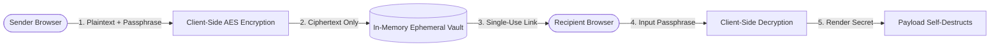

# SecretSnap — Ephemeral Secure In-Memory Message Vault

> A zero-knowledge privacy platform engineered for sharing confidential credentials, temporary passwords, and sensitive notes through client-side encryption and burn-on-read destruction.

[](https://www.typescriptlang.org/)
[](https://react.dev/)
[](https://tailwindcss.com/)

---

## Executive Overview

SecretSnap is a privacy-first web application designed to transfer confidential text strings (passwords, API secrets, private recovery keys) over public networks without leaving persistent digital footprints. The application executes cryptographic encryption directly in browser memory before generating a single-use access link. Once viewed by the authorized recipient, the encrypted payload self-destructs immediately.

---

## Core Capabilities & Features

### Implemented Capabilities
- **Browser-Side In-Memory Encryption:** Text payloads are transformed into encrypted strings before network dispatch; the server never receives plaintext.
- **Burn-on-Read Self-Destruction:** Single-use retrieval tokens guarantee that payloads cannot be re-read once unlocked.
- **Particle Visualization Canvas (`ParticlesBackground.tsx`):** Dynamic floating particle animations provide aesthetic security feedback.
- **Guided Step Workflow (`StepIndicator.tsx`):** Intuitive 3-step creation, key generation, and link sharing workflow.
- **Decryption Panel (`ReceiverPanel.tsx`):** Clean decryption viewer validating passphrase accuracy before rendering secrets.

---

## System Architecture



---

## Directory Structure

```text
Secret-snap/
├── src/
│   ├── components/
│   │   ├── BrandHeader.tsx          # Brand header and security badges
│   │   ├── EncryptedPanel.tsx        # Encryption form and parameter inputs
│   │   ├── ParticlesBackground.tsx  # Dynamic HTML5 canvas particle backdrop
│   │   ├── ReceiverPanel.tsx         # Decryption verification and display
│   │   ├── StepIndicator.tsx        # Guided 3-step execution indicator
│   │   └── ui/                      # Modular UI component abstractions
│   ├── App.tsx                      # Main application view container
│   ├── main.tsx                     # React DOM root mounting
│   └── index.css                    # Tailwind utility and theme styles
├── package.json                     # Project manifest and build scripts
└── README.md                        # Master repository technical documentation
```

---

## Setup & Installation

```bash
# Clone the repository
git clone https://github.com/StratagemVX/Secret-snap.git
cd Secret-snap

# Install dependencies
npm install

# Start development server
npm run dev
```

---

## Contributor Attribution & Profile

- **Lead Engineer:** Chethan Kumar B S (`StratagemVX`)
- **GitHub:** [https://github.com/StratagemVX](https://github.com/StratagemVX)
- **Portfolio:** [https://chethan-kumar-portfolio.vercel.app/](https://chethan-kumar-portfolio.vercel.app/)
- **LinkedIn:** [https://linkedin.com/in/chethan-kumar-b-s-781a002bb](https://linkedin.com/in/chethan-kumar-b-s-781a002bb)

## Verification and maintenance

Keep this README consistent with implemented behavior, current dependencies, and deployment configuration.

### Available package scripts

- `npm run dev` — `vite`
- `npm run build` — `vite build`
- `npm run lint` — `eslint .`
- `npm run preview` — `vite preview`

These commands are declared in the package manifest; no execution result is implied by listing them.

### Contribution and security notes

- Update feature, architecture, and screenshot material when implementation changes.
- Keep credentials, private keys, production data, and local environment files out of version control.
- Use placeholder-only configuration examples and store real secrets in deployment-managed settings.
- Include reproducible issue steps and expected/actual results.
- Run the relevant build, lint, and test checks before merging.
